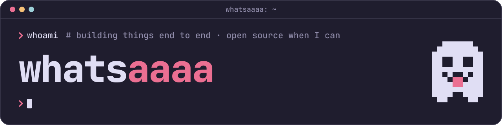

I build web applications from top to bottom: Vue and Nuxt on the front, C#/.NET and Go with Postgres on the back. My favorite part is owning the whole thing, from the database schema to the last button on the page. I'm a bit of a nerd about clean architecture and good tooling, and I like trying languages and frameworks outside my usual stack.

## Projects

- [form-builder](https://github.com/whatsaaaa/form-builder): define Formisch forms in JSON, render them with your own components, or compile them to typed Valibot code. [Docs](https://whatsaaaa.github.io/form-builder/)
- [design-system](https://github.com/whatsaaaa/design-system): my brand identity, design tokens, typography, docs theme and asset kit.
- [building-blocks](https://github.com/whatsaaaa/building-blocks): the foundation every one of my .NET products is built on.
- [dotfiles](https://github.com/whatsaaaa/dotfiles): my macOS setup, written down as code.

## Links

- Website: [whatsaaaa.github.io](https://whatsaaaa.github.io/)
- npm: [@whatsaaaa](https://www.npmjs.com/org/whatsaaaa)

Questions, ideas, bug reports and pull requests are all welcome, so feel free to say hi.
